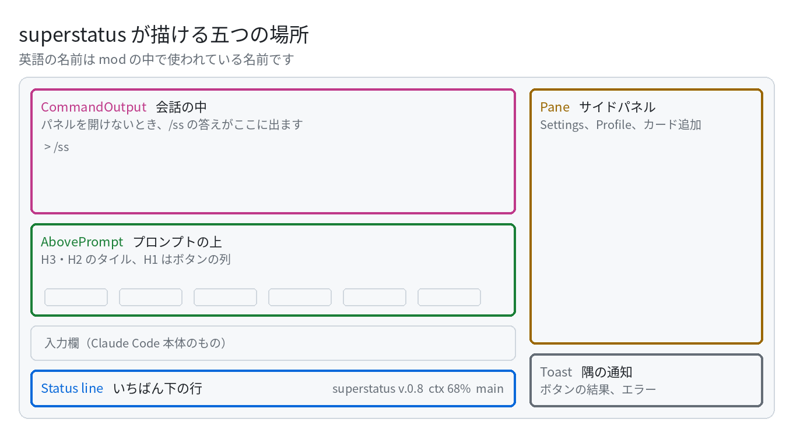

# superstatus

[English](README.md) · [繁體中文](README.zh-TW.md) · **日本語**

Claude Code のウィンドウの下半分を、あなただけの小さなダッシュボードにします。

プロンプトの下にはステータス行が増えて、context の残りや使用量がいつでも見られます。プロンプトの上には、グラフや
カウントダウン、ポモドーロ、ボタンの列を置けます。何をどこに置くかは自由です。`/ss` で設定パネルを開いて、
ゆっくり整えてください。

画面の数字はすべて、あなたのコンピューター、プロジェクトのフォルダー、Claude Code 自身から取っています。
外のサービスには何も送りません。

> **ベータ版です。** 三台のマシンで毎日使われていて、自動テストは 560 本ありますが、ほかの環境ではまだあまり
> 動かしていません。mod は Claude Code の新しい機能なので、今後のバージョンで描き方が変わるかもしれません。

> 名前は併記します。英語が mod とパネルに実際に出る名前で、日本語はその対訳です。

## どこに表示されるか

<picture>
  <source media="(prefers-color-scheme: dark)" srcset="assets/places-ja-dark.png">
  
</picture>

### Status line ステータス行：いちばん下の一行

短い情報を一行に並べます。バージョン、自動圧縮までの context の残り、5 時間と週ごとの使用量、git のブランチと
未保存のファイル。どれも `/ss` でオン・オフでき、自分のカードを足すこともできます。

<!-- photo: the status line alone -->

### AbovePrompt プロンプトの上：あなたのダッシュボード

上から順に、いくつかの段に分かれています。

| ブロック | 向いているもの |
|---|---|
| **H3**（一列いっぱいの `-full`、半分の `-half` もあり） | グラフ：ディスク、ホストの負荷、コミットの活動、使用量のリングとバー |
| **H2**（`-full`、`-half` もあり） | 一マス一行：数字つきのバー、短いメモ、カウントダウン |
| **H1** | ボタンの列（touchbar）：最大 12 個、多いときは ‹ › でページ送り |

ボタンを押すと、スラッシュコマンド、ひとこと（自分で入力したのと同じように）、または `!` で始まるシェルの
コマンドを送れます。

ポモドーロも入っています。`/ss pomo start` で 25 分の集中が始まり、`pause` で一時停止、`reset` でリセット、
`break` で 5 分の休憩です。`/ss pomo start` を送るボタンを一つ作れば、それがスタートボタンになります。

<!-- photo: the band with charts, and a GIF of the pomodoro counting -->

### Pane サイドパネル：会話の横

`/ss` を打つと、会話の横に **Settings** パネルが開きます。カードごとのオン・オフ、サイズ、並び順、それに言語
（English、繁體中文、日本語）と広い・狭いレイアウトをここで調整します。**Profile** では配置まるごとの保存と
読み込み、**カード追加** では手でカードを一枚足せます。

<!-- photo: the Settings pane -->

### 会話の中と、画面の隅

サイドパネルを開けないときは、`/ss` の答えが会話の中に出ます。ボタンの結果やエラーは、画面の隅に少しのあいだ
通知（Toast）として出ます。

## インストール

**いちばん簡単な方法**（Mac でも Linux でも）：ターミナルの Claude Code のプロンプトに次の一行を入力し、marketplace を
追加するか聞かれたら `y`、続いて範囲を選びます（最初の「ユーザー」なら、すべての session で使えます）。

```
/plugin install superstatus --marketplace eeesliao/superstatus
```

デスクトップアプリでは `/plugin` が使えません。プロンプト欄の横の **+** から **Plugins**、**Add marketplace** で
`eeesliao/superstatus` を入れ、**Add plugin** を押してください。この方法では四つの Profile は置かれません。
Releases から **superstatus-v0.8-profiles.zip** をダウンロードするか（どのシステムでも可。置き場所は中の README.txt に
あります）、下の Mac 用インストーラーを使ってください。

**Mac**：Releases から zip をダウンロードして展開し、ターミナルでインストーラーを実行します。何かを変える前に
必ず確認します。先に何をするのか見たいときは `--dry-run` を付けてください。ファイルには一切触れません。

```sh
sh ~/Downloads/superstatus-v0.8/install.sh --dry-run
sh ~/Downloads/superstatus-v0.8/install.sh
```

インストーラーがすることは三つです。mod を `~/.claude/ccssm` に置く。`~/.claude/settings.json` に設定を二つ
足す（先にバックアップを取ります）。そして `/ss` から見える場所に四つの Profile を置く：**Empty** と、三つの
言語の見本です。同じ名前のファイルがすでにあれば上書きしません。外したいときは `uninstall.sh` を実行してください。
Profile は残ります。署名なしの `.pkg` もありますが、zip のほうが簡単です。

**それ以外の環境**では、mod のフォルダーを Claude Code に直接渡します。

```sh
CLAUDE_CODE_PLUGIN_DIRS=/path/to/superstatus claude
```

あとは新しい session を開いて `/ss` を打てば始まります。

## 空っぽから始める、見本から始める

`/ss` を開いて **Profile** を押し、使いたいものの横の **Load** を押します（この辺りのボタンはまだ英語表示です）。

| Profile | 読み込むと |
|---|---|
| **Empty** | バージョンだけ。まっさらな枠組みで、ゼロから自分で組み立てたいときに |
| **カードとボタンの見本**（言語ごとに一つ） | 九枚のカードで、種類ごとに一枚ずつ：テキスト、カウントダウン、ファイルの一行、コマンドの出力、グラフ二つ、スイッチ一つ、ボタン二つ |

実際に読み込む前に、その Profile の中でコンピューター上で何かを実行するカードが一覧で出ます。さらに今の状態が
**before-load** として保存されるので、ボタン一つで元に戻せます。

あとは `/ss` の中で、自分のものに作り替えていきます。

- カードの**名前**を押す：そのカードのオン・オフ
- カードの真ん中の**サイズ**（`H2`、`H3`…）を押す：別のブロックへ移動
- **編集** を押す：ドラッグで並べ替え。自分で足したカードはクリックで名前を変更
- **削除** でカードを外し、**デフォルト** で内蔵のカードを戻す
- 気に入ったら **Profile** で **Save** を押して名前を付けます。このファイルは別のコンピューターにも持っていけます

## 自分の Claude と一緒にカードを設計する

形式を覚える必要はありません。いつもの言葉で、欲しいものを伝えるだけです。

> *ビルドが通ったかとディスクの残りをひと目で見たい。*
> *幫我在上面放一張倒數卡，算到 2027 年 1 月 1 日。*
> *Add something useful for my work.*

superstatus は、カードの一覧・追加・変更のためのツールを Claude に渡します。ルールはパネルと同じなので、誰も設定
ファイルを直接いじりません。ツールには進め方も書いてあります。「何か便利なのを」としか言わなかった場合、Claude は
まず、ふだん何の仕事をしているか、聞かなくても見えていてほしいものは何か、これはどのコンピューターか、を尋ねる
ことになっています。そのうえでカードを二、三枚提案し、それぞれどこに置くか、なぜかを説明し、名前はあなたの言葉で
付けます。追加するのは、あなたが「いいよ」と言ったものだけです。内蔵のグラフでは読めないもの（GPU、ジョブの
キュー、自分のログなど）は、あなたのコンピューターのパスとコマンドに合わせた小さなモジュールファイルを書きます。

## コンピューター上で何かを実行するカード

三種類のカードは何かを実行します。しかも **Claude Code の権限確認を通りません**。

- **Command card コマンドカード**：ターンの終わりごとに一回実行し（最大 3 秒）、出力の一行目を表示
- **Button ボタン**：中身が `!` で始まるものは、押すと残りを実行（最大 5 秒）
- **Switch card スイッチカード**：押すとスラッシュコマンドを送る

Claude が追加したこの種のカードと、見本に入っているものは、**最初は必ずオフ**です。自分で `/ss` からオンに
するまで、何も実行されません。人からもらったカードは、人からもらったシェルスクリプトと同じつもりで扱ってください。

## Modules モジュール

モジュールは、何かを読み取って描くグラフです。内蔵のものは session、git、ホストをカバーしています。自分のものを
足すには、`<プロジェクト>/.claude/superstatus/modules/` に JSON ファイルを一つ置きます。実行するコマンドと、
出力のどこに数字があるかを書けば、描くのは superstatus がやります。中身はデータであってプログラムではないので、
モジュールファイルが任意の JavaScript を実行することはありません。`examples/` に手直しして使える例が三つあり、
Claude に頼めば手元のツールで書いてくれます。

## 既知の問題

- **`/ss pomo start` を入力して送ると、まれに反応がありません。** Claude Code が「どの hook も答えなかった」と返し、
  ポモドーロは始まりません。原因はまだ調べています。ほかの `/ss` コマンドでは今のところ起きていません。そのときは、
  プロンプトの上のポモドーロのボタンを押すか、もう一度送ってください。

## 動作環境

- **Claude Code 2.1.299 以降。** それより古いと、このパネルを受け付けず、自前のものを描きます。
- macOS または Linux。Windows はまだ試していません。ホスト系のグラフ（ディスク、負荷）は Linux の `/proc` を読むので、Mac では `?` になります。
- 時刻（カウントダウンの日付、Profile の保存時刻）は、session が動いているコンピューターのタイムゾーンに従います。

## ライセンス

Apache-2.0。Copyright eE (LIAO YI HSUAN)。詳しくは `LICENSE` と `NOTICE` をご覧ください。
