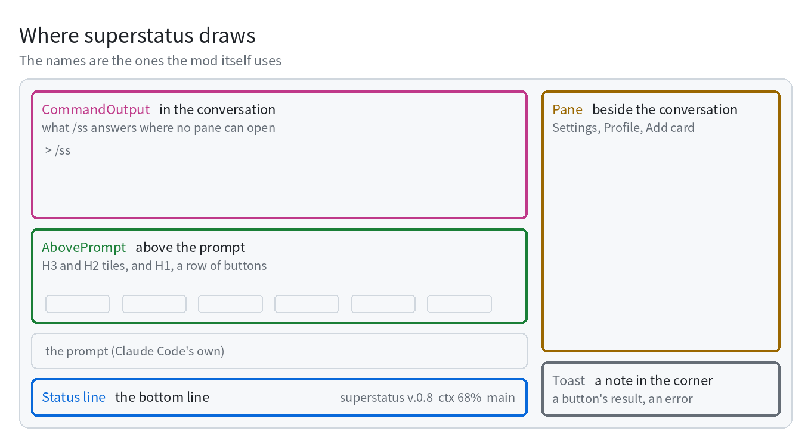

# superstatus

**English** · [繁體中文](README.zh-TW.md) · [日本語](README.ja.md)

Turn the bottom of your Claude Code window into a small dashboard of your own.

A status line under the prompt shows how much context is left and how much of your quota you have used. Above the
prompt you can put charts, countdowns, a pomodoro and a row of buttons — whatever you want, wherever you want it.
Type `/ss` to open the settings and arrange it at your own pace.

Every number on screen comes from your own computer, your project folder and Claude Code itself. Nothing is sent
anywhere.

> **Beta.** It runs every day on three machines and has 559 automated tests, but it has not met many other setups
> yet. Mods are a new part of Claude Code, so the way they draw may change as Claude Code changes.

## Where you will see it

<picture>
  <source media="(prefers-color-scheme: dark)" srcset="assets/places-en-dark.png">
  
</picture>

### Status line: the bottom line

A single line of short facts: the version, how much context is left before Claude Code compacts it, your 5-hour and
weekly quota, the git branch and any unsaved files. Turn each one on or off in `/ss`, and add cards of your own.

<!-- photo: the status line alone -->

### AbovePrompt: your dashboard

It comes in layers, from the top down:

| Block | Good for |
|---|---|
| **H3** (also `-full` for a whole row, `-half` for half) | charts: rings and bars for disk, host load, commit activity, quota |
| **H2** (also `-full`, `-half`) | one line each: a bar with a number, a short note, a countdown |
| **H1** | the button row (touchbar): up to 12 buttons, with ‹ › to page through when there are more |

A button can send a slash command, a sentence (just as if you had typed it), or a shell command that starts
with `!`.

There is a pomodoro built in: `/ss pomo start` begins 25 minutes of focus, `pause` holds it, `reset` clears it and
`break` gives you 5 minutes off. Make a button that sends `/ss pomo start` and that is your start key.

<!-- photo: the band with charts, and a GIF of the pomodoro counting -->

### Pane: beside the conversation

`/ss` opens the **Settings** pane next to the conversation. Every card's switch, size and order is there, along
with the language (English, 繁體中文, 日本語) and a wide or narrow layout. **Profile** saves and loads whole
arrangements, and **Add card** lets you add one by hand.

<!-- photo: the Settings pane -->

### In the conversation, and in the corner

When a pane can't open, `/ss` answers right in the conversation. A button's result or an error appears briefly as
a note in the corner (a toast).

## Install

**The quickest way**, on Mac or Linux: type this at the prompt of Claude Code in a terminal, answer `y` to add the
marketplace, then pick a scope (the first, your user, puts it in every session):

```
/plugin install superstatus --marketplace eeesliao/superstatus
```

In the desktop app, where `/plugin` does not run: click **+** next to the prompt box, then **Plugins**, **Add marketplace**
with `eeesliao/superstatus`, then **Add plugin**. A plugin installed this way does not place the four profiles: download
**superstatus-v0.8-profiles.zip** from Releases (any system; its README.txt says where they go), or use the Mac installer below.

**On a Mac**, download the zip from Releases, unzip it and run the installer in Terminal. It asks before it changes
anything. If you'd like to see what it plans to do first, add `--dry-run` and it won't touch a single file:

```sh
sh ~/Downloads/superstatus-v0.8/install.sh --dry-run
sh ~/Downloads/superstatus-v0.8/install.sh
```

The installer does three things: it puts the mod in `~/.claude/ccssm`; it adds two settings to
`~/.claude/settings.json` (backing the file up first); and it puts four profiles where `/ss` can find them —
**Empty** and the template in three languages. If a file with the same name is already there, it is left alone.
To remove everything, run `uninstall.sh`; your profiles stay. There is also an unsigned `.pkg`, but the zip is the
simpler road.

**Anywhere else**, point Claude Code at the mod folder yourself:

```sh
CLAUDE_CODE_PLUGIN_DIRS=/path/to/superstatus claude
```

Then start a new session and type `/ss` to begin.

## Start from empty, or start from the template

Open `/ss`, press **Profile**, and press **Load** next to the one you want:

| Profile | What you get |
|---|---|
| **Empty** | just the version — a clean frame for building your own from scratch |
| **Every card and button** (one per language) | nine cards, one of each kind: a text, a countdown, a line from a file, a command's output, two charts, a switch and two buttons |

Before anything loads, the pane lists the cards in that profile that would run something on your computer, and it
saves your current setup as **before-load**, so you are always one press away from going back.

Then make it yours, right in `/ss`:

- press a card's **name** to turn it on or off
- press the **size** in the middle of a card (`H2`, `H3`, …) to move it to another block
- press **Edit** to drag cards into a new order; click a card you added to rename it
- **Delete** removes a card, and **Default** brings the built-in ones back
- happy with it? Go to **Profile**, press **Save** and give it a name. The file can travel to another computer, too

## Design your cards with your own Claude

There is no format to learn. Just say what you want, in whatever language you like:

> *I want to see at a glance whether my build passed and how much disk is left.*
> *幫我在上面放一張倒數卡，算到 2027 年 1 月 1 日。*
> *仕事に役立つカードを追加して。*

superstatus gives Claude the tools to list, add and change cards, under the same rules as the panel, so nobody edits
the settings file by hand. The tools also tell Claude how to go about it: if all you say is "add something useful",
it should first ask what you work on, what you'd like to see without having to ask, and which computer this is.
Then it offers two or three cards, says where each would go and why, names them in your language, and adds only the
ones you agree to. For something no built-in chart can read — a GPU, a job queue, a log of your own — it writes a
small module file that uses your computer's own paths and commands.

## Cards that run things on your computer

Three kinds of card run something, and **they do not go through Claude Code's permission prompt**:

- a **command card** runs once at the end of every turn (3 s at most) and shows the first line of its output
- a **button** whose text starts with `!` runs the rest when you press it (5 s at most)
- a **switch card** sends a slash command when you press it

Cards like these that Claude adds for you, and the ones in the templates, **always start switched off**: nothing
runs until you turn it on yourself in `/ss`. Treat a card someone gives you the way you would treat a shell script
someone gives you.

## Modules

A module is a chart that reads something and draws it. The built-in ones cover the session, git and the host. To
add your own, put a JSON file in `<project>/.claude/superstatus/modules/` saying which commands to run and where the
numbers are in their output, and superstatus does the drawing. It is data, not code: a module file can never run
arbitrary JavaScript. `examples/` has three you can adapt, or simply ask Claude to write one with the tool it has.

## Known issues

- **Typing `/ss pomo start` sometimes gets no answer.** Claude Code replies that no hook answered it, and the pomodoro does
  not start. The cause is not found yet; the other `/ss` commands have not shown it. Press the pomodoro's button in the band
  instead, or send the command once more.

## Requirements

- **Claude Code 2.1.299 or later.** Older versions refuse the panel and draw their own instead.
- macOS or Linux. Windows is not tested yet. The host charts (disk, load) read Linux's `/proc`, so on a Mac they show `?`.
- Times (a countdown's day, when a profile was saved) follow the time zone of the computer the session runs on.

## Licence

Apache-2.0. Copyright eE (LIAO YI HSUAN). See `LICENSE` and `NOTICE`.
