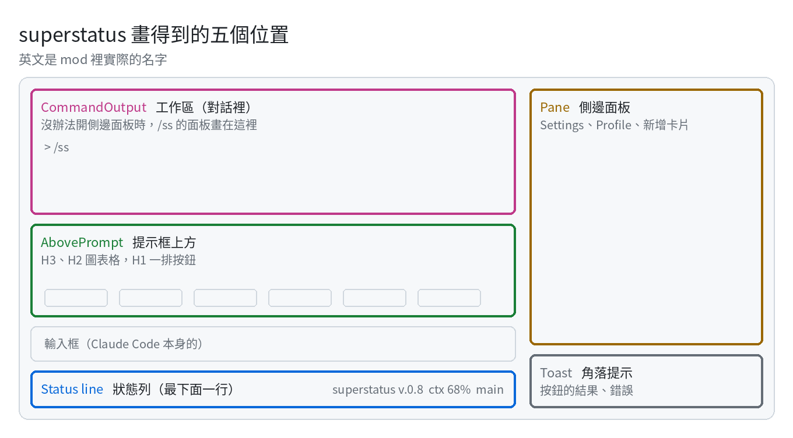

# superstatus

[English](README.md) · **繁體中文** · [日本語](README.ja.md)

把 Claude Code 視窗的下半部，變成一塊屬於你的小儀表板。

提示框下面多一行狀態列，隨時看得到 context 還剩多少、額度用了多少；提示框上面可以擺圖表、倒數、蕃茄鐘和一排按鈕，
要放什麼、放哪裡都由你決定。打 `/ss` 就能打開設定面板慢慢調。

畫面上的每個數字都來自你自己的電腦、你的專案資料夾和 Claude Code 本身，不會連到任何外部服務。

> **目前是 Beta。** 已經在三台機器上每天使用、有 560 個自動測試，但還沒在更多人的環境裡跑過。mod 是 Claude Code
> 很新的功能，之後版本更新時，畫面的做法可能會跟著變。

> 名稱採雙語：英文是 mod 和面板上實際顯示的名字，中文幫你對照。

## 它會出現在哪裡

<picture>
  <source media="(prefers-color-scheme: dark)" srcset="assets/places-zh-TW-dark.png">
  
</picture>

### Status line 狀態列：最下面那一行

一行簡短的資訊：版本、自動壓縮前 context 還剩多少、5 小時和每週的額度、git 分支和還沒存的檔案。每一項都能在
`/ss` 裡開關，也可以放你自己的卡片進來。

<!-- photo: the status line alone -->

### AbovePrompt 提示框上方：你的儀表板

由上到下分成幾層：

| 區塊 | 適合放 |
|---|---|
| **H3**（另有 `-full` 整排、`-half` 半排） | 圖表：磁碟、主機負載、提交活動、額度的圓環和長條 |
| **H2**（另有 `-full`、`-half`） | 一格一行：一條帶數字的長條、一句短短的文字、倒數 |
| **H1** | 按鈕列（touchbar）：最多 12 顆，按鈕一多就用 ‹ › 翻頁 |

按鈕按下去，可以送出一個斜線指令、一句話（就像你自己打的一樣），或是用 `!` 開頭的 shell 指令。

還內建了蕃茄鐘：`/ss pomo start` 開始專注 25 分鐘，`pause` 暫停、`reset` 歸零、`break` 休息 5 分鐘。做一顆
送出 `/ss pomo start` 的按鈕，它就是蕃茄鐘的開始鍵。

<!-- photo: the band with charts, and a GIF of the pomodoro counting -->

### Pane 側邊面板：對話旁邊

打 `/ss` 會在旁邊打開 **Settings** 面板：每張卡片的開關、尺寸、順序，還有語言（English、繁體中文、日本語）和
寬窄版，都在這裡調。面板上的 **Profile** 用來存檔、載入整套安排，**新增卡片** 可以手動加一張。

<!-- photo: the Settings pane -->

### 對話裡，和角落

沒辦法開側邊面板的時候，`/ss` 會直接回在對話裡。按鈕的結果或錯誤，會在角落短暫出現一個提示（Toast）。

## 安裝

**最快的方法**，Mac、Linux 都可以：在終端機的 Claude Code 提示框打下面這行，問要不要加入 marketplace 時回 `y`，
再選範圍（第一個「你的使用者」會讓每個 session 都有它）：

```
/plugin install superstatus --marketplace eeesliao/superstatus
```

在桌面版裡 `/plugin` 不能用：按提示框旁邊的 **+**，選 **Plugins**、**Add marketplace**，填 `eeesliao/superstatus`，
再按 **Add plugin**。用這個方法裝的不會放那四份 Profile：到 Releases 下載 **superstatus-v0.85-profiles.zip**（任何系統都能用，
裡面的 README.txt 寫了要放哪裡），或用下面的 Mac 安裝程式。

**Mac**：到 Releases 下載 zip、解壓縮，在終端機執行安裝程式。它動任何東西之前都會先問你；想先看看它打算做什麼，
加上 `--dry-run` 就好，一個檔案都不會碰：

```sh
sh ~/Downloads/superstatus-v0.85/install.sh --dry-run
sh ~/Downloads/superstatus-v0.85/install.sh
```

安裝程式會做三件事：把 mod 放進 `~/.claude/ccssm`；在 `~/.claude/settings.json` 加兩個設定（會先幫你備份）；
再把四份 Profile 放到 `/ss` 找得到的地方，也就是 **Empty** 和三種語言的範本。同名的檔案已經在的話，不會被蓋掉。
想移除就執行 `uninstall.sh`，你的 Profile 會留著。另外也有一個沒簽章的 `.pkg`，不過用 zip 比較單純。

**其他環境**：自己把 mod 的資料夾指給 Claude Code：

```sh
CLAUDE_CODE_PLUGIN_DIRS=/path/to/superstatus claude
```

裝好之後開一個新的 session，打 `/ss` 就可以開始了。

## 從空白開始，或從範本開始

打開 `/ss`，按 **Profile**，在想要的那一份旁邊按 **載入**：

| Profile | 載入後 |
|---|---|
| **Empty** | 只剩版本號，乾乾淨淨的框架，適合從零開始自己蓋 |
| **各種卡片與按鈕範本**（每種語言一份） | 九張卡片，每一種各一張：文字、倒數、檔案裡的一行、指令的輸出、兩張圖表、一個開關、兩顆按鈕 |

真的載入之前，面板會先列出這份 Profile 裡哪些卡片會在你電腦上執行東西，並且先把你現在的樣子存成 **before-load**，
按一下就能回到原本的樣子。

接著在 `/ss` 裡，把它改成你自己的：

- 按卡片的**名稱**：打開或關掉這張卡片
- 按卡片中間的**尺寸**（`H2`、`H3`⋯）：換到別的區塊
- 按 **編輯**：拖曳卡片換順序；點你自己加的卡片可以改名
- **刪除** 拿掉一張卡片，**預設** 把內建的卡片找回來
- 滿意了，到 **Profile** 按 **存檔**，取一個自己的名字；這個檔案也能帶到另一台電腦

## 跟你自己的 Claude 一起設計卡片

不用學任何格式，用你習慣的語言，說你想要什麼就好：

> *我想一眼看到 build 有沒有過、硬碟還剩多少。*
> *幫我在上面放一張倒數卡，算到 2027 年 1 月 1 日。*
> *Add something useful for my work.*

superstatus 會把列出、新增、修改卡片的工具交給 Claude，規則跟面板完全一樣，沒有人會直接去改設定檔。工具裡也交代了
Claude 該怎麼做：如果你只說「加點有用的」，它要先問你平常在做什麼、想不用問就看到什麼、這是哪一台電腦；接著提出
兩三張卡片，說明每一張要放哪裡、為什麼，名稱用你的語言；你點頭的才加。內建圖表讀不到的東西（GPU、排程佇列、
你自己的 log），它會照你這台電腦的路徑和指令，幫你寫一個小小的模組檔。

## 會在你電腦上執行東西的卡片

有三種卡片會執行東西，而且**不會經過 Claude Code 的權限確認**：

- **Command card 指令卡**：每個回合結束時執行一次（最多 3 秒），顯示輸出的第一行
- **Button 按鈕**：內容用 `!` 開頭的，按下去就執行後面那段（最多 5 秒）
- **Switch card 開關卡**：按下去送出一個斜線指令

Claude 幫你加的這類卡片，還有範本裡的，**一律先是關著的**：你自己在 `/ss` 打開之前，什麼都不會執行。別人給你的
卡片，就用看待別人給你的 shell script 的心情來對待它。

## Modules 模組

模組就是一張會讀資料、再把它畫出來的圖表。內建的涵蓋 session、git 和主機。想加自己的，就在
`<專案>/.claude/superstatus/modules/` 放一個 JSON 檔：寫清楚要跑哪些指令、數字在輸出的哪裡，畫圖交給 superstatus。
它是資料、不是程式，模組檔永遠沒辦法執行任意的 JavaScript。`examples/` 裡有三個可以照著改，也可以直接請 Claude
用它手上的工具幫你寫。

## 已知問題

- **打字送出 `/ss pomo start` 偶爾沒有反應。** Claude Code 會回一句沒有 hook 回答它，蕃茄鐘也不會開始。原因還在找；其他
  `/ss` 指令目前沒有遇過。遇到時，改按提示框上方的蕃茄鐘按鈕，或再送一次就好。

## 需求

- **Claude Code 2.1.299 以上。** 比較舊的版本會拒絕這個面板，改畫它自己的。
- macOS 或 Linux。Windows 還沒測過。主機類的圖表（磁碟、負載）讀的是 Linux 的 `/proc`，在 Mac 上會顯示 `?`。
- 時間（倒數卡的日期、Profile 的存檔時間）跟著執行 session 那台電腦的時區走。

## 授權

Apache-2.0，版權 eE (LIAO YI HSUAN)。詳見 `LICENSE` 和 `NOTICE`。
